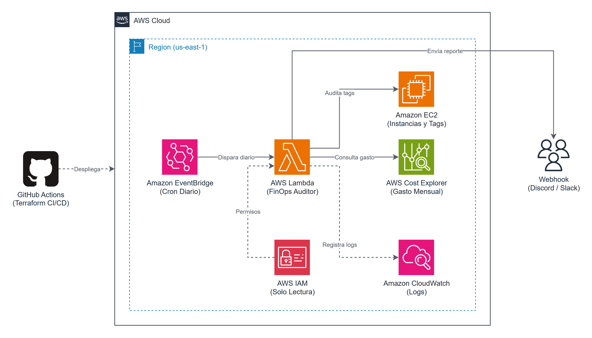

# AWS FinOps & Resource Auditor

[](https://aws.amazon.com/)
[](https://www.python.org/)
[](https://www.terraform.io/)
[](https://github.com/features/actions)

> Microservicio serverless en AWS provisionado con **Terraform** para auditoría diaria de gobierno de etiquetas en EC2 y seguimiento de gasto mensual en **Cost Explorer**, con alertas estructuradas por webhook y pipeline CI/CD en GitHub Actions.

---

## Contexto y Problema

En cuentas AWS compartidas o de laboratorio, dos fugas frecuentes de gobierno y FinOps son:
- **Recursos sin etiquetar:** instancias EC2 creadas sin tags obligatorios (`Owner`, `Environment`), lo que impide asignar costos por proyecto o responsable.
- **Falta de visibilidad diaria del gasto:** detectar anomalías recién al cierre de factura mensual.

Este proyecto automatiza una auditoría diaria programada sin servidores encendidos 24/7, validando cumplimiento de etiquetas en EC2 y reportando el gasto acumulado del mes vía webhook (Discord / Slack).

---

## Arquitectura del Sistema

Toda la infraestructura se define de forma declarativa en [terraform/](terraform/) y se despliega mediante [.github/workflows/deploy.yml](.github/workflows/deploy.yml):



### Flujo de Trabajo y Rol de cada Servicio

1. **Despliegue automatizado (`GitHub Actions` + `Terraform`):** Cada push a `main` ejecuta primero las pruebas unitarias con `pytest` y `moto`, y luego aplica la infraestructura en AWS mediante Terraform (`init`, `validate`, `plan`, `apply`).
2. **Programación diaria (`Amazon EventBridge`):** Una regla programada (`cron`) dispara automáticamente la función auditora una vez al día sin necesidad de mantener servidores encendidos.
3. **Ejecución y permisos (`AWS Lambda` + `AWS IAM`):** La función Lambda (Python 3.11) ejecuta la auditoría utilizando un rol IAM con permisos estrictos de solo lectura sobre EC2 y Cost Explorer.
4. **Auditoría de recursos y gasto (`Amazon EC2` + `AWS Cost Explorer`):** Lambda revisa las instancias EC2 activas para detectar aquellas sin etiquetas obligatorias (`Owner`, `Environment`) y consulta el gasto acumulado del mes en Cost Explorer.
5. **Observabilidad y alertas (`Amazon CloudWatch` + `Webhook`):** Los registros de cada ejecución quedan en CloudWatch Logs y el resumen diario se envía mediante un webhook a Discord o Slack.

---

## Decisiones Técnicas

- **Lambda minimalista (`128 MB`, timeout `30s`):** la carga es I/O-bound (llamadas Boto3 a EC2, Cost Explorer y un POST HTTP), por lo que 128 MB minimiza el costo de ejecución sin degradar la latencia.
- **Empaquetado reproducible en Terraform (`archive_file` + `source_code_hash`):** detecta cambios en `src/` automáticamente y actualiza el código de la función solo cuando cambia el hash SHA-256.
- **Nombres sin colisiones en IAM (`name_prefix`):** evita errores al recrear roles o políticas en redespliegues de Terraform.
- **Pruebas unitarias aisladas con `moto`:** simula llamadas a AWS EC2 y Cost Explorer en `pytest` sin tocar cuentas reales ni generar costos durante el CI.

---

## Seguridad e IAM

Controles implementados en [terraform/iam.tf](terraform/iam.tf), [terraform/ssm.tf](terraform/ssm.tf) y [.github/workflows/deploy.yml](.github/workflows/deploy.yml):

- **CI/CD sin claves estáticas (GitHub OIDC):** `deploy.yml` asume un rol IAM específico (`github-actions-finops-auditor-role`) restringido a `repo:VitoNez5198/aws-finops-auditor:ref:refs/heads/main`, eliminando `AWS_ACCESS_KEY_ID` y `AWS_SECRET_ACCESS_KEY`.
- **Estado remoto cifrado y bloqueado (Terraform S3 Backend):** `terraform.tfstate` vive en un bucket S3 privado con versionado, cifrado SSE-S3 y bloqueo nativo (`use_lockfile = true`), evitando roles huérfanos entre despliegues.
- **Secretos en SSM Parameter Store (`SecureString`):** `WEBHOOK_URL` se almacena cifrado en `/finops-auditor/<env>/webhook-url` y Lambda solo tiene `ssm:GetParameter` sobre ese ARN exacto.
- **Principio de menor privilegio:** el rol de Lambda solo permite lectura sobre EC2 (`DescribeInstances`, `DescribeTags`, `DescribeVolumes`, `DescribeAddresses`), `ce:GetCostAndUsage`, `ssm:GetParameter` acotado y escritura en el Log Group específico de la función (con retención de 14 días).
- **Invocación restringida por origen:** `aws_lambda_permission` autoriza únicamente al principal `events.amazonaws.com` condicionado por el `source_arn` exacto de la regla de EventBridge.

---

## FinOps y Control de Costos

Desglose transparente para **1 ejecución diaria** (`cron(0 13 * * ? *)`, ~30 ejecuciones/mes):

| Servicio AWS | Uso mensual estimado | Costo estimado |
| :--- | :--- | :--- |
| **Amazon EventBridge** | 30 eventos programados | **$0.00 USD** (capa gratuita) |
| **AWS Lambda** | 30 invocaciones × 128 MB (< 5s c/u) | **$0.00 USD** (Free Tier: 1M req/mes) |
| **CloudWatch Logs** | < 5 MB de logs | **$0.00 USD** (Free Tier: 5 GB/mes) |
| **AWS Cost Explorer API** | 30 llamadas `ce:GetCostAndUsage` ($0.01/llamada) | **~$0.30 USD/mes** |

> Sin instancias EC2 ni bases de datos encendidas 24/7. El único costo variable es la API de Cost Explorer ($0.01 por consulta); si se requiere estricto $0.00, puede reemplazarse por notificaciones directas de **AWS Budgets**.

---

## Estructura del Repositorio

```text
aws-finops-auditor/
├── .github/
│   └── workflows/
│       └── deploy.yml         # Pipeline CI/CD: pytest + terraform plan/apply
├── docs/
│   ├── architecture.drawio    # Fuente editable del diagrama (Draw.io / AWS4)
│   └── architecture.png       # Diagrama de arquitectura serverless y CI/CD
├── src/
│   ├── lambda_function.py     # Handler de AWS Lambda (lectura SSM + orquestación)
│   ├── ec2_auditor.py         # Auditoría de EC2 sin tags, EBS huérfanos y Elastic IPs
│   ├── cost_auditor.py        # Consulta de gasto mensual en Cost Explorer
│   └── notifier.py            # Envío de alertas formateadas vía webhook
├── terraform/
│   ├── main.tf                # Providers AWS/archive + backend remoto S3
│   ├── variables.tf           # Región, entorno, cron, tags obligatorias, webhook
│   ├── ssm.tf                 # Parámetro SecureString para WEBHOOK_URL
│   ├── iam.tf                 # Rol y política IAM acotada (EC2/CE/SSM/Logs)
│   ├── lambda.tf              # Empaquetado ZIP, Log Group (14d) y función Lambda
│   ├── eventbridge.tf         # Regla Cron, target y permiso de invocación
│   └── outputs.tf             # ARNs, nombre de función y parámetro SSM
├── tests/
│   └── test_auditor.py        # Pruebas unitarias con pytest y moto
├── .gitignore
└── README.md
```

---

## Pruebas y Despliegue

### Pruebas locales
```bash
pip install pytest moto boto3
pytest tests/ -v
```

### Despliegue manual con Terraform
```bash
cd terraform
terraform init
terraform validate
terraform plan -var="webhook_url=https://discord.com/api/webhooks/..."
terraform apply -var="webhook_url=https://discord.com/api/webhooks/..."
```

---

## Autor

**Víctor Martínez** — Junior Cloud Engineer | AWS, FinOps & Applied AI  
AWS Certified Cloud Practitioner • AWS Cloud re/Start • En preparación para SAA-C03

- **Portafolio:** [vitonez5198.github.io/Portfolio-VM](https://vitonez5198.github.io/Portfolio-VM/)
- **LinkedIn:** [victor-ms-dev](https://www.linkedin.com/in/victor-ms-dev/)
- **GitHub:** [@VitoNez5198](https://github.com/VitoNez5198)
